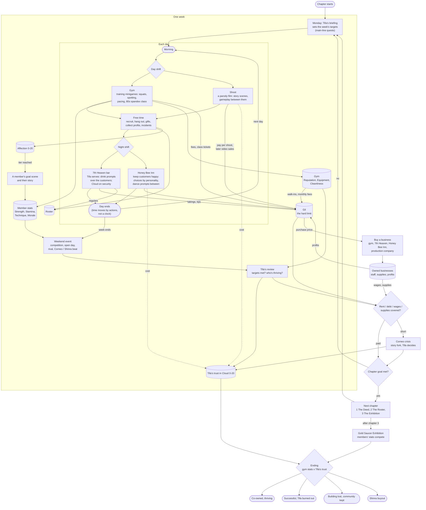
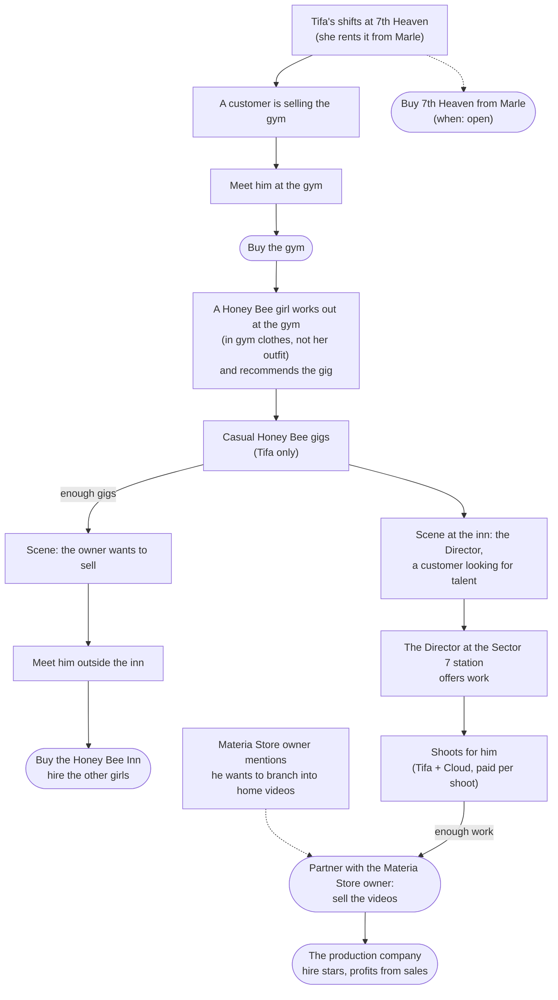

# The Gym: plan

The new direction (user, 2026-10): openFF7 becomes a game with no combat. It is
built on minigames that are tracked, and on relationships. Tifa buys the Wall
Market gym (`mkt_mens`, the Men's Hall: Big Bro's squat contest), and the story
grows around it.

This file holds the design and its decisions, plus the audit of what the project
already has: what is kept, consolidated, replaced or removed. Decisions are
marked **(decided)**; everything else is a proposal.

---

## 1. Premise

- **Tifa is the plot's anchor, not the player (decided).** She owns the gym:
  she signs the deed, carries the debt and makes the calls at the story's
  forks. **Cloud is the player**: her right hand, head trainer and fixer. He
  recruits, spots, runs errands and plays the minigames.
  - This also keeps Cloud as the field leader, so the shelved leader work is
    not needed.
- **Theme:** strength without fighting. The gym is a place where slum people
  get power over their own lives.
- **Antagonists:**
  - Don Corneo as landlord: rent rises, his lackeys come round to "inspect".
  - Shinra's corporate fitness centre: Scarlet comes with a buyout offer.

## 2. Story arc

1. **The Deed.** Tifa works her shifts at 7th Heaven, with Cloud around the
   bar. A customer there is selling
   the gym (who: Big Bro fits; he owes Corneo); Cloud meets him at the gym and
   buys it before Corneo takes it. First members come through the squat
   contest. First rent is due. (Order of unlocks: section 4.2.)
2. **The Roster.** Recruiting across Midgar, then the world. Each recruit has a
   personal goal; helping them reach it is the relationship.
3. **The Exhibition.** Shinra's buyout, then a public competition at the Gold
   Saucer. The result depends on the gym's stats, the members' stats and how
   much Tifa trusts Cloud.

**Endings:** they come from the gym's stats and Tifa's trust in Cloud.

| Gym stats | Trust | Ending |
|---|---|---|
| High | High | Co-owned, thriving, partners |
| High | Low | Successful, but she is burned out and it isn't hers any more |
| Low | High | They lose the building but keep the community (the church / the playground) |
| Low | Low | Shinra buys them out |

## 3. Weekly loop

Flowchart (also `docs/gym_loop.mmd`):

1. **Monday:** Tifa's briefing at the gym office. She sets the week's targets;
   these are main-line quests in the 600 framework, as external-giver quests.
2. **Each day (user): a day shift and a night shift**, each with its own
   minigame (section 6.2).
   - **Day shift:** the gym or a shoot for the Director.
   - **Night shift:** the 7th Heaven bar or the Honey Bee Inn.
   - Each is open once it's unlocked (section 4.2).
   - **Between the shifts: free time (user)** for recruiting and hanging
     out (also gifts, collecting profits, incidents).
3. **The weekend:** an event (a competition, an open day, a rival, a Corneo or
   Shinra beat), then Tifa's review, where the gym stats and her trust change.

**Time passes through actions, not a clock (user).** A day moves on as you
work its shifts, not as play time runs.

- **Save data:** a day counter and the day's phase (morning / day shift done /
  free time / night shift done), a few bytes.
  - The phase advances when a shift ends.
  - **Free-time actions cost a slot (user):** one action (a hang-out, a
    date, a recruiting visit) per free time, so every day forces a choice.
  - Sleeping (or the night shift's end) starts the next day.
  - Every seventh day is the weekend.
- **What changes:** everything that counts play minutes moves to days or
  actions.
  - the Honey Bee "Collect" (HB_RATE x stars x minutes, from `q_clock`)
  - the Director's "come back in 30 minutes" pay (670 `MOVIE_AT`)
  - the bounty timers
  - Profits build per day worked instead.

## 4. Money: gil is the hard limit (user)

You start with some gil and must keep an income that covers rent and the
other expenses. Running short is the pressure that drives every week.

- **Expenses:**
  - rent (to Corneo, rising)
  - Big Bro's debt instalments in chapter 1
  - equipment (bought and repaired)
  - wages (instructors, the bar)
  - supplies (towels, protein, cleaning: Cleanliness falls without them)
  - fines and "inspections"
- **Income, conventional:**
  - **Gym:** monthly member fees (members x tier, more with Reputation),
    drop-in class tickets (the spandex class), personal training sessions
    (a minigame score sets the fee), competition prize money.
  - **7th Heaven bar-tending (user: Tifa works the shifts, not Cloud):** the
    bar's takings and tips, and regulars who become gym recruits. Open: what
    Cloud, the player, does during a shift (a minigame helping her, or just
    the takings collected), and whether shifts cost Tifa time she'd otherwise
    give the gym.
- **Income, unconventional:** the Director and the Honey Bee Inn (section
  4.1). They start as work done out of desperation and become businesses you
  own.
- **Tracking:**
  - Gil is the real wallet (GOLDU / GOLDD / CHGLD, as now).
  - The week's ledger (income by source, expenses) is shown at Tifa's
    review; it needs a few save bytes for this week's totals.
- **Failure:** rent short = the Corneo crisis (section 3), not a game over;
  repeated misses lead to the buyout ending.

### 4.1 Owned businesses (user)

The game's progression is **buying assets**. Each one needs staff and supplies,
and pays out profits you collect.

**Assets:**
- 7th Heaven
- the gym
- the Honey Bee Inn
- the production company
- more to come

Each asset has:

| | |
|---|---|
| **Purchase price** | a gil goal that a chapter can be built around |
| **Staff** | hired, then paid wages every week; who works there sets the income |
| **Resources** | supplies bought to keep it running (stock, equipment, film); short supplies cut income |
| **Profits** | build up while you're away; collected in person, as the Honey Bee manager's "Collect" does now (gil x rate x minutes, capped) |
| **Upgrades** | later: more staff slots, better equipment, higher rates |

**The Director and the Honey Bee Inn: desperation, then ownership.** In the
gym's story these scenes are about making money out of desperation, and they
add flavour to life in the slums.

- **The Honey Bee Inn:**
  - **Before you own it:** only Tifa works there. It's quick money when rent
    is short, at a cost: Tifa's trust, and her own feelings about it.
  - **After you buy it:** you hire the others. 620's recruiting (finding the
    girls around the world, the star questions) becomes hiring staff. The inn
    then pays profits, less their wages.
- **The Director:**
  - **Before you own the company:** shoots with only Tifa and Cloud, paid per
    shoot (670's pay-per-press). The Director is the boss.
  - **Buy the production company:** you hire the stars (the co-stars: Ruby,
    Skye, Elena, Scarlet, Aerith, ...) and the Director himself, as paid
    staff.
  - **Sell the videos:** a deal with the Materia Store salesman in Wall
    Market (`mkt_m`) to sell them from his shop. The deal is a scene; then he
    pays your share of sales.
  - **The shift:** from being paid for a shoot to collecting profits. Each
    shoot makes a video; videos sell over time, by its quality (the meter's
    score, finishers) and its stars.
- **7th Heaven** (user): Tifa only rents it; the building belongs to
  **Marle**, the elderly Sector 7 landlady, and is bought from her. The bar
  shifts are Tifa's; owning it adds staff, stock and profits.
- **The gym** is the first purchase (section 4.2).

### 4.2 Unlock chain (user)

Each business is found through the one before it:

- **Gym:**
  - Cloud meets the seller as a customer at 7th Heaven.
  - The purchase happens at the gym.
- **Honey Bee Inn:**
  - The casual employment unlocks when a Honey Bee girl, working out at the
    gym in ordinary clothes, recommends the gig.
  - After enough gigs, there's a scene where the owner shares that he wants
    to sell.
  - You meet him outside the inn to buy it.
- **The Director** (renamed from "the cameraman"):
  - First met in a scene at the inn, as a customer looking for talent.
  - From then on he is at the Sector 7 train station (where 670 already puts
    him) and offers work.
- **Video sales:**
  - The Materia Store owner (`mkt_m`) mentions earlier, in ordinary talk,
    that he wants to branch into home videos.
  - After enough work for the Director, you can partner with him to sell the
    videos.
  - The plan's "production company" is this step: owning the shoots, hiring
    stars, profits from sales. Whether it's a separate purchase or the deal
    itself: open.
- **7th Heaven:** when you buy it from Marle is open (some gil goal along the
  way).
- **Name clash:** 677's scene lab NPC is also called "the Director": rename
  one of them.

**Save data per asset** (estimate, from the free bytes `save-usage` found):
an owned bit, staff bits, a supply level, unpaid profit or its last-collected
minute (2 bytes), an upgrade level. That is ~5-6 bytes an asset, plus the
videos' stock / sales counters for the production company.

## 5. Tracking

- **Per member:**
  - Strength / Stamina / Technique / Morale, raised by minigame scores.
  - Morale falls if they're neglected.
  - Affection 0-20.
- **Tifa's trust in Cloud:** 0-20, its own track. It gates the forks and the
  ending.
- **The gym:**
  - Money.
  - Reputation: ranks Back-alley, Slum Favourite, Sector Name, Midgar Famous,
    Saucer Champion.
  - Equipment tier.
  - Cleanliness.
  - Reputation brings walk-in members, who pay monthly.
- **Records board in the gym:** each member's best score in each minigame.
- **Screens:** the Quests screen for goals, and the affection list (680) for
  members and Tifa.

## 6. Minigames

- **The original minigames, reframed** (launched with the `MINIGAME` opcode, as
  180 does):
  - squats: the core rep
  - Gold Saucer arcade: arm wrestling, punching, basketball
  - snowboard / Speed Square / G-Bike: outdoor sessions
  - chocobo racing: the endurance club
  - Fort Condor: defending the gym from the buyout
  - Junon parade: rhythm class
  - CPR: first-aid certificate
- **New minigames on the movie's meter** (670: press-rate gauge, cursor, a band
  to hold, Square prompts):
  - spotting: keep the lifter in the safe band
  - pacing: runs and spin classes
  - Square prompts for a perfect rep

### 6.1 Group fitness: 80s spandex classes (user)

An aerobics class in the gym, done 80s style.

- **Look:** leotards over tights, leg warmers, headbands, sweatbands, neon.
- **Instructor:** cycles between Tifa, Jessie (the actress) and Andrea Rhodea
  (dance).
- **Class:** members in rows; they join as they're recruited.
- **Built mostly on what exists:**
  - **682's school dance:**
    - its move system: `_dance_poses.py`, poses on Ruby's skeleton, retargeted
      per girl
    - its formations on a grid
    - its synchronised routine with `ROUTINE` / `SHOUTS`
    - its outfit builder: `_uniform` on `_female_body`, painted parts, its own
      skirt part
  - **Replace the uniform** with leotard + tights + leg warmers + headband: a
    paint scheme and a band builder (the stockings' `_banded` already does
    sharp colour bands).
  - **New moves for the routine:** grapevine, jumping jacks, step-touch, high
    kicks, arm circles, knee lifts, the "jazz hands" finish.
- **Gameplay (new):** 682 is passive; the class becomes a rhythm minigame.
  - Cloud does the class too. Press on the beat: the meter's band, or the
    Square prompt on each move change.
  - The class's score raises each attending member's Stamina and Morale, and
    the gym's Reputation.
  - Members out of step (low Technique) are shown with offset moves.
- **Class nights on the calendar;** a full class is a Reputation event.

### 6.2 Shift minigames (user)

**Night: the 7th Heaven bar.** Tifa serves; the minigame works like the Junon
parade's (timed button prompts).

- **The customers:** they sit around the bar and order drinks. Each order
  shows a button prompt over that customer; each drink is a button. Pressing
  the right button in time serves it, and tips depend on the timing.
- **Cloud is security:** one of the inputs deals with a rowdy drunk when one
  kicks off. Ignored, a drunk scares off customers or costs the night's
  takings.
- **The night's score** gives the takings and tips (gil). It's also where
  regulars come from (gym recruits, the gym seller in section 4.2).
- **Build** (proposal): a field-script minigame like the movie's meter (670).
  - Button-glyph sprites placed over each customer (the icon sprite system:
    `_icon_pixels`, sprite models).
  - One small entity polling each button once a frame (the 8-ops-a-frame
    limit; 670's `keys` / `sqkey`).
  - Timing windows counted in frames.
  - The original parade's script is worth reading first: how it times its
    prompts.
  - The set: a copy of 7th Heaven's bar room.

**Night: the Honey Bee Inn (user): keep the customers happy.**

- **Personalities:** every customer has a personality, and it decides which
  choices are right. It works like the dates' conversations (660's
  questions with a right answer, the profiles in `_movie_profiles` /
  `_backstories`), except the goal is keeping him happy, not answering him.
  Each choice raises or lowers his mood.
- **Prompts between decisions:** button prompts for the standard actions
  (dances and the like: the Honey Bee dancer's existing dance anims DXHE /
  DXIB / ...), timed as the bar's.
- **The night's result:** each customer's mood at the end sets the takings
  and tips, plus the inn's reputation once you own it.
- **Before you own it:** only Tifa works these shifts, which costs her trust
  as section 4.1 says. After the purchase: the hired girls, each better with
  some personalities (proposal).
- **Reuses:** the dates' choice / affection logic, 670's prompt icons and
  per-button polling, onna_4 / onna_52 as the rooms.

**Day: the gym.** The training minigames (section 6: squats, spotting,
pacing) and the 80s spandex class (6.1).

**Day: a shoot (user): parodies with storylines.** The shoots change from
one position after another into films.

- **Structure:** each film is a parody with a storyline, told in scenes.
  Gameplay comes between the scenes.
- **What carries over:** 672's special scenes are closest: a scenario,
  staged intro lines, actions per line, then positions. The press-rate meter
  (670), the Square prompts and the holds can be the gameplay between scenes;
  other kinds of play can be added.
- **Parody targets (user): FF7's own world.**

  **Approved (user):**

  | Film | Parody of | Set | Cast |
  |---|---|---|---|
  | *Hostile Takeover* | the Shinra board meeting: executives fight over the budget | the boardroom (blin66 floors) | Scarlet as the cruel exec, Elena as the new hire (proposal) |
  | *Going up* (**built: 684_going_up, untested in-game**) | the Turks' elevator capture, turned round: the stuck glass elevator, Tifa's 'special training' for Elena | Shinra HQ's glass elevator (eleout) | Cloud, Tifa, Elena (user) |
  | *Mako Fever* | a reactor inspection with a stuck elevator | No.1 / No.5 reactor rooms | Cloud, Tifa, Jessie (user) |
  | *Escape Pod* | Shinra's space programme, sealed in with too little air | the rocket's capsule (rcktin7) | Cid, Aerith (user) |

  Jessie is new to the shoots: she needs an undressed model (the standard
  body on her story model, as 675 does for the others) and a profile.

  **Tifa and Cloud only** (user: many are needed, shot before anyone else
  is hired). Midgar sets reachable early. Approved (user):

  | Film | Parody of | Set |
  |---|---|---|
  | *Last Train Out* | the opening train ride: the ID scan, nervous passengers, a carriage to themselves | the Sector 7 train |
  | *Happy Hour* | 7th Heaven after closing; the pinball-machine lift down to the hideout | 7th Heaven (mds7pb_1 / mds7pb_2) |
  | *Avalanche Boot Camp* | the bombing mission briefing; Tifa as the drill instructor | the hideout (mds7pb_2) |
  | *Sector 7 Workout* (**built: 683_workout, untested in-game**) | a gym training montage: Tifa's first visit, Cloud spots her squats; squat prompts, pace by hits | the gym (mkt_mens) |
  | *Parade Rehearsal* | the Junon parade drill (user: Cloud and Tifa; a drill instructor shouts positions and a short button prompt asks for the right one: a wrong or late press loses the take) | Junon |

  Still proposals:

  | Film | Parody of | Set |
  |---|---|---|
  | *Under the Stars* | the water tower promise: "if you're ever in trouble, I'll come" | the Nibelheim water tower (or a Midgar rooftop) |
  | *Ex-SOLDIER for Hire* | Cloud's "anything for a price" mercenary act, Tifa as the client | the Sector 7 slums |
  | *Dress to Impress* | the Wall Market dress-up: Tifa coaches Cloud for his audition | the Boutique (mkt_s1) |
  | *The Don's Bride* | Corneo choosing a bride; Tifa picked, Cloud sneaks in to save her | Corneo's bedroom (colne_6) |

  **The main cast (user): Aerith, Tifa, Jessie, Scarlet, Elena, Esther
  (potentially) and a custom nurse; Ruby and Skye are written out.**

  - **Jessie** needs an undressed model (the standard body on her story
    model, as 675 does for the others) and a profile.
  - **Esther** isn't in the original game: she needs a model built or
    borrowed, and a profile.
  - **The nurse** is 679_nurse's island nurse (ZIUA, with her anim suite).
  - **Ruby and Skye leave the story**, but Skye's undressed body stays as
    an asset: `_female_body`'s standard body (every girl's undressed model)
    is built from 670's `_bare_skye`. Removing her from the shoots must keep
    that build.
  - Their lines, profiles and star ranks in 670 / 678 / 679 go with the
    restructure.

  **Later casts** (proposals; reworked with the user's notes):

  - ***Mouth to Mouth*** (Costa del Sol; user: a more specific parody, people
    needing CPR). A lifeguard show, built on FF7's own CPR scene (Cloud
    reviving Priscilla at Junon). Cloud is the lifeguard on Costa del Sol's
    beach. One "drowning" swimmer after another needs CPR, and each turns
    out to be faking it to get his attention: Tifa, Aerith, Jessie, Elena on
    leave, Scarlet on a company holiday.
    - Gameplay: the CPR rhythm (Junon's minigame: press and breathe in time)
      between the scenes.
    - Each "victim" has her own excuse for the fake.
  - ***Castaways*** (user: the Tiny Bronco floating after Rocket Town). The
    Tiny Bronco, shot down by Shinra, adrift as a boat: a desert-island
    parody.
    - Cid insists she's still a plane and appoints himself captain.
    - Scarlet, who ordered the attack, is shot down with them on her own
      inspection flight, and has to share the rations.
    - Cast: Cid, Scarlet, Cloud.
    - Gameplay: bailing water and rowing prompts between scenes, a Shinra
      plane overhead to signal or hide from.
  - ***The Bodyguard*** (Aerith; user: Flower girl needs a parody). The
    film the game half-tells already: Aerith hires Cloud as her bodyguard,
    the fee "one date". She's a flower seller treated like a pop star,
    hounded by the Turks; he's sworn to keep her safe and not fall for her.
    - Gameplay: escort prompts (a Turk jumps out: the right button blocks
      him) and flower-selling between scenes.
    - Set: the Sector 5 church and slums.
  - ***Saucer Slam*** (Battle Square; user: a wrestling parody). Gold Saucer
    pro wrestling with Dio as the showman promoter.
    - Elena the by-the-book face, Scarlet the heel ("Kyahaha!"), Tifa the
      real fighter nobody can script, Esther as manager or ring announcer.
    - Cloud is the referee who gets "knocked out" at the worst moment.
    - Gameplay: move prompts in the ring (grapple button sequences) and a
      crowd-heat meter (670's meter reused).
  - ***Specimen*** (Scarlet, the nurse): Hojo's lab and its 'experiments',
    in the Shinra Mansion basement.
  - ***Night Shift*** (user): Tifa, Jessie and Aerith star as nurses on
    Mideel's clinic's night shift, with a patient (Cloud) who won't stay in
    bed (ithos, 679_nurse's set).
    - Costume (user): one generic nurse outfit for all three, on each
      girl's own head and feet.
    - Built the way 682's school uniforms are: the standard body painted
      with the outfit (`_female_body.tifa_body(paints=)` + `_uniform`).
      The island nurse (679_nurse) is a separate model and stays a
      character of her own.

  Each film: an opening scene that sets up the parody, two or three scenes
  with gameplay between them, a finale. 672's scenarios and 674's acts are
  the closest existing structures, and their lines can be rewritten into
  films rather than written from scratch.
- **One film = one shoot day** (proposal). It becomes a video for the
  Materia Store deal; its score sets its sales.

## 7. Relationships

- **Cloud and members:** affection 0-20.
  - **Earned by:** training with them, gifts (625's shops, re-stocked: protein
    bars, wraps, new gloves), the right answer in a talk, turning up to their
    events.
  - **Tiers unlock:**
    - their goal's scene
    - a hang-out (660's date places, with Cid's friend version (661) as the
      template)
    - their story (the `_backstories` approach)
- **Cloud and Tifa:** trust 0-20, raised only through the gym's success and
  their scenes. Her arc is learning to let others carry part of the load.
- **Members with each other:** rivalries and friendships in group-class
  cutaways (the loose engine's break scenes). Pairing members well lifts both.

### Recruits (first list)

| Recruit | Goal | Training angle |
|---|---|---|
| Barret | strong enough to carry Marlene "forever" | lifting; pride vs. form |
| Jessie | stunt stamina for a stage comeback | cardio, timing; aerobics instructor |
| Wedge | lose weight, gain confidence | comedy and heart |
| Biggs | discipline, a goal that isn't Avalanche | routine streaks |
| Aerith | flexibility; mostly here for the people | stretching; the social hub |
| Cid | quit smoking, get his wind back | stamina; relapse events |
| Yuffie | speed; also wants to steal the trophy | agility; a trust meter |
| Red XIII | why do humans do this | observer turned coach |
| Vincent | insomnia | night classes |
| Andrea Rhodea | rival turned dance instructor | rhythm classes |
| Big Bro | the old owner, sore about selling | rival turned assistant coach |

## 8. Audit of the existing project

| Kind | Meaning |
|---|---|
| **Keep** | foundation, used as is |
| **Consolidate** | its mechanics become a gym system |
| **Replace** | the gym version takes its place |
| **Remove?** | the user decides |

| Patch / module | Now | Proposal |
|---|---|---|
| 010-450 (new game, pinning, open Midgar / world, travel, vehicles) | open-world foundation | **Keep**. 010's new game later starts the gym story. |
| 200-230 recruits | party joins in the world | **Consolidate**: join the party *and* the gym roster; the recruit talk becomes the gym pitch. |
| 250 / 280 trains, chocobo rides | travel | **Keep** |
| 600 quests (framework, Quests screen, markers) | 90 quests, mostly kill quests | **Keep the framework, replace the content.** Kill quests don't fit with no combat: new kinds `score` (a minigame result) and `attend` (an event). Givers become Tifa's briefings plus members' goals. |
| 620 Honey Bee recruitment (stars, questions, hire, Collect income) | recruit + income loop | **Restructure (user, section 4.1)**: Tifa alone until you buy the inn, then 620's recruiting becomes hiring staff and its Collect becomes the asset's profits. Which rooms / scenes stay: open. |
| 625 gift shops | gifts -> affection | **Keep**, re-stocked for members |
| 626 Honey Bee rescue | random street event | **Remove?** (or reshape as a slum incident that brings a self-defence student) |
| 630 bounties / 640 Hunt Quartermaster | combat bounties, hunter ranks, gear shop | **Replace**: the rank ladder becomes gym Reputation, the shop becomes the equipment supplier. Bounty logic goes if combat goes. |
| 660 dates / 661 Cid friend | dates, hang-outs, affection tiers | **Consolidate** into member hang-outs (661 is the template). Intimate part twos: **remove?** |
| 670-674, 678, 679_* movie shoots, special scenes, Blast-off, stage show, group/beach/chamber/nurse sets | adult minigame suite | **Restructure (user, section 4.1)**: Tifa + Cloud paid per shoot, then buy the production company: hire the stars and the Director, sell the videos at the Materia Store. The star ranks / co-star unlocks become hiring; which sets / scenes stay: open. Its engine parts are worth keeping: the meter, Square prompts, holds/pauses as pacing, the loose engine's staged cutaways, new-field copying, sprite gauges. |
| 682 school dance | passive dance routine, uniforms | **Consolidate** into the 80s spandex class (section 6.1) |
| 675 / 681 / `_female_body`, 985, 990 | bodies, model merging, hand edits | **Keep** (needed for outfits). The undressed variants go with whatever is removed. |
| 677 scene lab | placement tool | **Keep** |
| 680 affection list | Square list | **Keep**: members + Tifa's trust |
| `_movie_profiles`, `_backstories` | character bibles | **Consolidate**: rewrite as the members' bibles |
| debug (990_debug) | travel, flags | **Keep**, plus gym shortcuts |
| shelved/ (500 tame, 950 leaders) | not built | Leave shelved |

### Combat

**Decided (user, 2026-10): combat goes, for now.** It may come back later; it
isn't a priority.

- **Done:** `950_no_combat.py` turns random battles off while
  `_config.COMBAT` is False.
  - Every field's encounter tables are disabled (181 fields).
  - The world map's encounter roll always says "no battle".
  - Flipping `COMBAT` back to True restores both.
- **Not done yet:** the scripted battles. 84 fields still have a `BATTLE` op
  in code that can run:
  - openFF7's own boss lines (600's quest bosses, 130 HQ roof / elevator,
    170 Reno, 180 Motor Ball, 250 Guard Scorpion / Air Buster, 626's thugs)
  - original story fights the pinning leaves reachable (most behind flags
    that never get set)
  - the world map's scripted fights in wm*.ev

  They are to be removed or turned into non-combat beats with the rest of the
  restructure (the list comes from scanning the build's reachable code).
- **Knock-on effects:**
  - Kill quests (600) and bounties (630) can no longer be finished: they
    count battle kills. They are replaced by gym quests anyway (section 8).
  - Cloud no longer levels up.
  - Chocobo catching (a battle) and Yuffie's world map encounter are gone.
    230 recruits Yuffie as an NPC.
  - The debug menu's encounters toggle does nothing.

## 9. Technical constraints

- **Save space** (measured with `ff7tool.py save-usage`, 2026-10, on the build;
  details in `work/save_usage.txt`):
  - **~155 whole bytes are free** in savemap banks 1-4:
    - bank 1: 31
    - bank 2: 53
    - bank 3: 10
    - bank 4: 59
  - Plus 76 bytes to check by hand (just after an exe reference: perhaps part
    of a table) and many spare bits in flag bytes.
  - The gym needs ~60 bytes (~5 a member x ~12, plus the gym, Tifa and the
    week), so it fits without removing anything.
  - **The open world itself frees almost nothing (1 byte):** pinned fields
    still test their story flags in code that can still run. Removing
    features frees their bytes: bank 1 188-223 (Honey Bee / movie, 36) and
    their quest bytes.
  - Not covered by the scan:
    - battle AI (scene.bin can read savemap)
    - exe code that reaches the savemap through a register base
    - what the original game's menus copy whole
  - Bounty state is exe-only and not saved, so it is no model for stats.
- **Text ids are 8-bit (255 a field):** busy fields need gym scenes in new
  fields copied from others (as the dates do).
  - Free maplist names are nearly gone (see `docs/dates_plan.md`).
  - Removed sets free theirs: subin_4, whitebg1-2, blin69_2, trap, junmon, qe,
    pass, hyou14, xmvtes, fallp, m_endo, shpin_22, nivgate3, hyou12,
    blackbge/k/a/f/g, fship_26, convil_3, onna_1/3/6.
- **mkt_mens:** 13 entities, 60 texts, original squat contest. Its script needs
  dumping before planning the gym's own scenes.

## 10. Order of work (proposed)

1. Decide the audit's **Remove?** rows and combat.
2. Removal pass: delete or shelve the dropped patches. The build and tests stay
   green, and CLAUDE.md is updated.
3. Save layout for the gym (`_config`): members, gym, Tifa, week.
4. Chapter 1, The Deed:
   - mkt_mens taken over: Big Bro, the purchase, Tifa's office
   - squats as the first training minigame
   - the first Monday briefing
5. Encounters off by default.
6. The spandex class (from 682).
7. Roster, goals, hang-outs; then the Exhibition.
