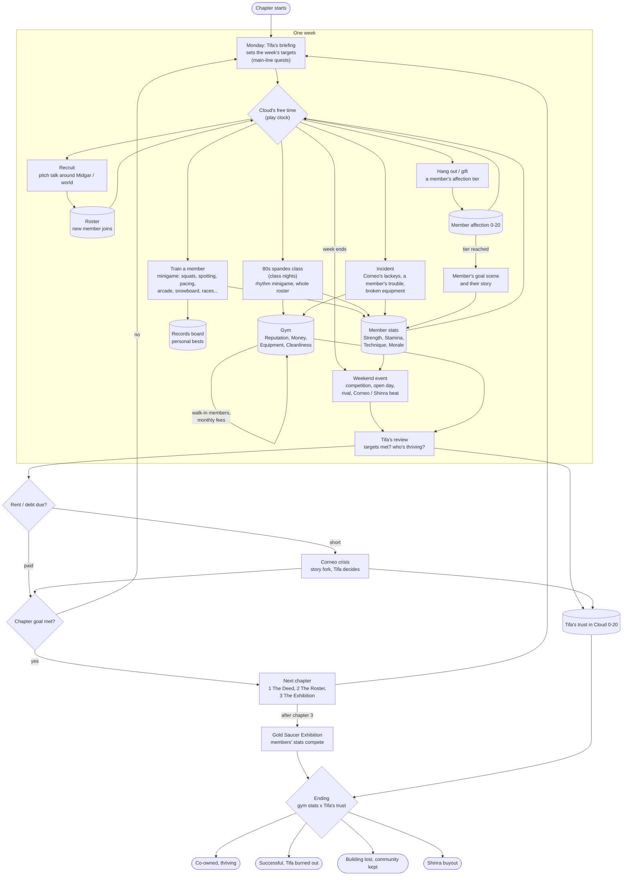

# The Gym: plan

The new direction (user, 2026-10): openFF7 becomes a game with no combat. It is
built on minigames that are tracked, and on relationships. Tifa buys the Wall
Market gym (`mkt_mens`, the Men's Hall: Big Bro's squat contest), and the story
grows around it.

This file holds the design and its decisions, plus the audit of what the project
already has: what is kept, consolidated, replaced or removed. Decisions are
marked **(decided)**; everything else is a proposal.

---

## 1. Premise

- **Tifa is the plot's anchor, not the player (decided).** She owns the gym:
  she signs the deed, carries the debt and makes the calls at the story's
  forks. **Cloud is the player**: her right hand, head trainer and fixer. He
  recruits, spots, runs errands and plays the minigames.
  - This also keeps Cloud as the field leader, so the shelved leader work is
    not needed.
- **Theme:** strength without fighting. The gym is a place where slum people
  get power over their own lives.
- **Antagonists:**
  - Don Corneo as landlord: rent rises, his lackeys come round to "inspect".
  - Shinra's corporate fitness centre: Scarlet comes with a buyout offer.

## 2. Story arc

1. **The Deed.** Big Bro owes Corneo, and Tifa buys the gym before Corneo
   takes it. First members come through the squat contest. First rent is due.
2. **The Roster.** Recruiting across Midgar, then the world. Each recruit has a
   personal goal; helping them reach it is the relationship.
3. **The Exhibition.** Shinra's buyout, then a public competition at the Gold
   Saucer. The result depends on the gym's stats, the members' stats and how
   much Tifa trusts Cloud.

**Endings:** they come from the gym's stats and Tifa's trust in Cloud.

| Gym stats | Trust | Ending |
|---|---|---|
| High | High | Co-owned, thriving, partners |
| High | Low | Successful, but she is burned out and it isn't hers any more |
| Low | High | They lose the building but keep the community (the church / the playground) |
| Low | Low | Shinra buys them out |

## 3. Weekly loop

Flowchart (also `docs/gym_loop.mmd`):

1. **Monday:** Tifa's briefing at the gym office. She sets the week's targets;
   these are main-line quests in the 600 framework, as external-giver quests.
2. **The week:** Cloud's free time.
   - Recruit people.
   - Train members (minigames).
   - Handle incidents.
   - Hang out with members.
3. **The weekend:** an event (a competition, an open day, a rival, a Corneo or
   Shinra beat), then Tifa's review, where the gym stats and her trust change.
   - Time comes from the play clock (`q_clock`, var[2][247] = minutes).

## 4. Tracking

- **Per member:**
  - Strength / Stamina / Technique / Morale, raised by minigame scores.
  - Morale falls if they're neglected.
  - Affection 0-20.
- **Tifa's trust in Cloud:** 0-20, its own track. It gates the forks and the
  ending.
- **The gym:**
  - Money.
  - Reputation: ranks Back-alley, Slum Favourite, Sector Name, Midgar Famous,
    Saucer Champion.
  - Equipment tier.
  - Cleanliness.
  - Reputation brings walk-in members, who pay monthly.
- **Records board in the gym:** each member's best score in each minigame.
- **Screens:** the Quests screen for goals, and the affection list (680) for
  members and Tifa.

## 5. Minigames

- **The original minigames, reframed** (launched with the `MINIGAME` opcode, as
  180 does):
  - squats: the core rep
  - Gold Saucer arcade: arm wrestling, punching, basketball
  - snowboard / Speed Square / G-Bike: outdoor sessions
  - chocobo racing: the endurance club
  - Fort Condor: defending the gym from the buyout
  - Junon parade: rhythm class
  - CPR: first-aid certificate
- **New minigames on the movie's meter** (670: press-rate gauge, cursor, a band
  to hold, Square prompts):
  - spotting: keep the lifter in the safe band
  - pacing: runs and spin classes
  - Square prompts for a perfect rep

### 5.1 Group fitness: 80s spandex classes (user)

An aerobics class in the gym, done 80s style.

- **Look:** leotards over tights, leg warmers, headbands, sweatbands, neon.
- **Instructor:** cycles between Tifa, Jessie (the actress) and Andrea Rhodea
  (dance).
- **Class:** members in rows; they join as they're recruited.
- **Built mostly on what exists:**
  - **682's school dance:**
    - its move system: `_dance_poses.py`, poses on Ruby's skeleton, retargeted
      per girl
    - its formations on a grid
    - its synchronised routine with `ROUTINE` / `SHOUTS`
    - its outfit builder: `_uniform` on `_female_body`, painted parts, its own
      skirt part
  - **Replace the uniform** with leotard + tights + leg warmers + headband: a
    paint scheme and a band builder (the stockings' `_banded` already does
    sharp colour bands).
  - **New moves for the routine:** grapevine, jumping jacks, step-touch, high
    kicks, arm circles, knee lifts, the "jazz hands" finish.
- **Gameplay (new):** 682 is passive; the class becomes a rhythm minigame.
  - Cloud does the class too. Press on the beat: the meter's band, or the
    Square prompt on each move change.
  - The class's score raises each attending member's Stamina and Morale, and
    the gym's Reputation.
  - Members out of step (low Technique) are shown with offset moves.
- **Class nights on the calendar;** a full class is a Reputation event.

## 6. Relationships

- **Cloud and members:** affection 0-20.
  - **Earned by:** training with them, gifts (625's shops, re-stocked: protein
    bars, wraps, new gloves), the right answer in a talk, turning up to their
    events.
  - **Tiers unlock:**
    - their goal's scene
    - a hang-out (660's date places, with Cid's friend version (661) as the
      template)
    - their story (the `_backstories` approach)
- **Cloud and Tifa:** trust 0-20, raised only through the gym's success and
  their scenes. Her arc is learning to let others carry part of the load.
- **Members with each other:** rivalries and friendships in group-class
  cutaways (the loose engine's break scenes). Pairing members well lifts both.

### Recruits (first list)

| Recruit | Goal | Training angle |
|---|---|---|
| Barret | strong enough to carry Marlene "forever" | lifting; pride vs. form |
| Jessie | stunt stamina for a stage comeback | cardio, timing; aerobics instructor |
| Wedge | lose weight, gain confidence | comedy and heart |
| Biggs | discipline, a goal that isn't Avalanche | routine streaks |
| Aerith | flexibility; mostly here for the people | stretching; the social hub |
| Cid | quit smoking, get his wind back | stamina; relapse events |
| Yuffie | speed; also wants to steal the trophy | agility; a trust meter |
| Red XIII | why do humans do this | observer turned coach |
| Vincent | insomnia | night classes |
| Andrea Rhodea | rival turned dance instructor | rhythm classes |
| Big Bro | the old owner, sore about selling | rival turned assistant coach |

## 7. Audit of the existing project

| Kind | Meaning |
|---|---|
| **Keep** | foundation, used as is |
| **Consolidate** | its mechanics become a gym system |
| **Replace** | the gym version takes its place |
| **Remove?** | the user decides |

| Patch / module | Now | Proposal |
|---|---|---|
| 010-450 (new game, pinning, open Midgar / world, travel, vehicles) | open-world foundation | **Keep**. 010's new game later starts the gym story. |
| 200-230 recruits | party joins in the world | **Consolidate**: join the party *and* the gym roster; the recruit talk becomes the gym pitch. |
| 250 / 280 trains, chocobo rides | travel | **Keep** |
| 600 quests (framework, Quests screen, markers) | 90 quests, mostly kill quests | **Keep the framework, replace the content.** Kill quests don't fit with no combat: new kinds `score` (a minigame result) and `attend` (an event). Givers become Tifa's briefings plus members' goals. |
| 620 Honey Bee recruitment (stars, questions, hire, Collect income) | recruit + income loop | **Consolidate** the recruiting questions and the income Collect into gym recruiting / membership fees. Its explicit rooms and scenes: **remove?** |
| 625 gift shops | gifts -> affection | **Keep**, re-stocked for members |
| 626 Honey Bee rescue | random street event | **Remove?** (or reshape as a slum incident that brings a self-defence student) |
| 630 bounties / 640 Hunt Quartermaster | combat bounties, hunter ranks, gear shop | **Replace**: the rank ladder becomes gym Reputation, the shop becomes the equipment supplier. Bounty logic goes if combat goes. |
| 660 dates / 661 Cid friend | dates, hang-outs, affection tiers | **Consolidate** into member hang-outs (661 is the template). Intimate part twos: **remove?** |
| 670-674, 678, 679_* movie shoots, special scenes, Blast-off, stage show, group/beach/chamber/nurse sets | adult minigame suite | **Remove?** Its engine parts are worth keeping: the meter, Square prompts, holds/pauses as pacing, the loose engine's staged cutaways, new-field copying, sprite gauges. |
| 682 school dance | passive dance routine, uniforms | **Consolidate** into the 80s spandex class (section 5.1) |
| 675 / 681 / `_female_body`, 985, 990 | bodies, model merging, hand edits | **Keep** (needed for outfits). The undressed variants go with whatever is removed. |
| 677 scene lab | placement tool | **Keep** |
| 680 affection list | Square list | **Keep**: members + Tifa's trust |
| `_movie_profiles`, `_backstories` | character bibles | **Consolidate**: rewrite as the members' bibles |
| debug (990_debug) | travel, flags | **Keep**, plus gym shortcuts |
| shelved/ (500 tame, 950 leaders) | not built | Leave shelved |

### Combat

**Combat is not in this game.** What exists:

- The debug build already turns encounters off:
  - a field `BTLON` hold
  - the world map battle call stub
- Shipping those as the default removes random battles.
- Scripted boss lines (600's boss lines, 130's elevator, 180's Motor Ball,
  170's Reno) would be removed or turned into non-combat beats.

**Open:** whether any battle stays as a story beat (e.g. Corneo's enforcers).

## 8. Technical constraints

- **Save space:**
  - Bank 1 is full and 6 quest bytes are left.
  - The member stats need ~5 bytes x ~12 recruits, plus the gym and Tifa
    (~60 bytes).
  - Removing the Honey Bee and movie systems frees bank 1 188-223 (36 bytes)
    and their quest bytes.
  - Bounty state is exe-only and not saved, so it is no model for stats.
- **Text ids are 8-bit (255 a field):** busy fields need gym scenes in new
  fields copied from others (as the dates do).
  - Free maplist names are nearly gone (see `docs/dates_plan.md`).
  - Removed sets free theirs: subin_4, whitebg1-2, blin69_2, trap, junmon, qe,
    pass, hyou14, xmvtes, fallp, m_endo, shpin_22, nivgate3, hyou12,
    blackbge/k/a/f/g, fship_26, convil_3, onna_1/3/6.
- **mkt_mens:** 13 entities, 60 texts, original squat contest. Its script needs
  dumping before planning the gym's own scenes.

## 9. Order of work (proposed)

1. Decide the audit's **Remove?** rows and combat.
2. Removal pass: delete or shelve the dropped patches. The build and tests stay
   green, and CLAUDE.md is updated.
3. Save layout for the gym (`_config`): members, gym, Tifa, week.
4. Chapter 1, The Deed:
   - mkt_mens taken over: Big Bro, the purchase, Tifa's office
   - squats as the first training minigame
   - the first Monday briefing
5. Encounters off by default.
6. The spandex class (from 682).
7. Roster, goals, hang-outs; then the Exhibition.
